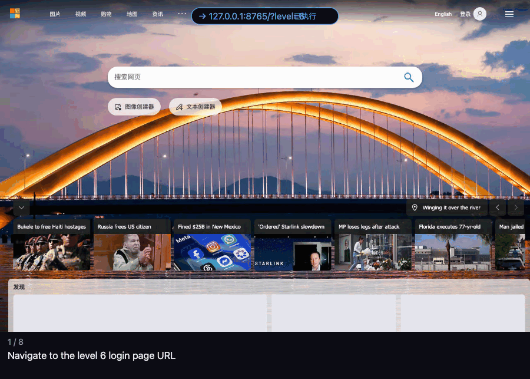
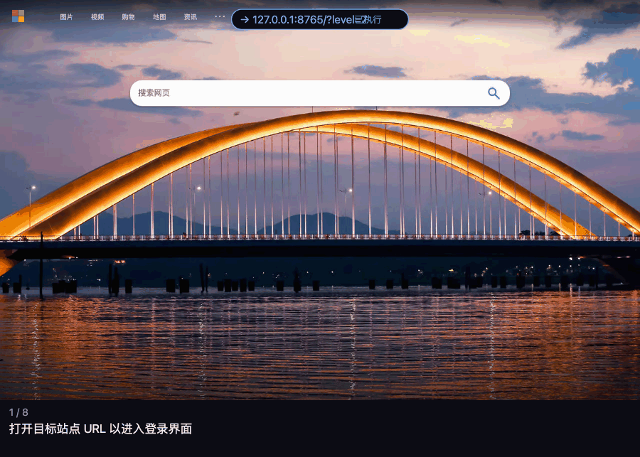
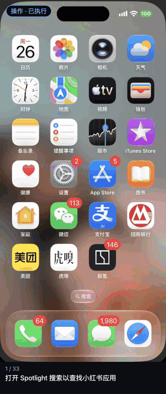

# seek-use

**让 DeepSeek 操作浏览器和手机。不赌模型，靠 Harness。**

Browser · Android · iPhone · 用 DeepSeek V4.1 Flash 跑通

> **源码整理中，整理完成后开放。** 这里先放介绍、真实运行的回放和基准测试材料。

https://github.com/user-attachments/assets/284cf2f3-ce4e-48c3-a973-786c4c13bcac

在 DeepSeek Harness 里描述一个界面任务，seek-use 在本机的浏览器、Android 或 iPhone 上完成它，交回结果和每一步的证据。
为 DeepSeek 补上操作真实界面的能力，用 V4.1 Flash 就能跑通。

它不指望模型每次都点对，而是给每一步加上检查：

**规划 → 提议动作 → 校验、执行、设备确认 → 前后截图对比验证**

点了没生效、输入框里不是想要的内容、模型给自己加了用户没说的限制，这类错误能在当步被检查出来，
退回重新规划，而不是带着错误继续往下走。所以一个便宜的 flash 模型也能把事情做对。

## 真实运行示例

下面是几次真实运行的回放，都用 DeepSeek V4.1 Flash。每一帧是一步操作，底部的文字是这一步的说明
（说明是模型自己写的，有的帧是英文）。

**Browser · 按顺序点字验证码**：在本地演示的登录页上登录，并按提示“请依次点击：风、南、东”逐个点出对应的字。

**Browser · 多选图片验证码**：在同一个登录页上，通过“选出所有含五角星的格子”的图片验证码。

| **Android**：在京东、淘宝、拼多多里搜索同一款水，比较价格 | **iPhone**：从小红书找书店合集，再到大众点评查评分和人均 |
| --- | --- |
|  |  |

## 公开基准（DeepSeek V4.1 Flash，pass@1）

| 基准 | 范围 | 结果 |
| --- | --- | --- |
| MobileWorld | Android，GUI-only 子集 | **96/117（82.1%）** |
| WebArena-Verified | Shopping / Shopping Admin，Hard 集 | **98/111（88.3%）** |

按基准自带的评测器判分，全程只用 DeepSeek V4.1 Flash，没有更强的模型兜底。
两个基准各抽样 10 条运行轨迹（MobileWorld 8 条通过 2 条失败，WebArena 9 条通过 1 条失败）的回放和官方评分见 [benchmarks/](benchmarks/README.md)。

## 项目特点

- **完整任务执行**：围绕任务目标持续观察、操作和检查，返回结果与完成依据；最终结果要经过审核才算完成。
- **三平台共用内核**：Browser、Android 真机或模拟器，以及 macOS 上的 iPhone 镜像。
- **结论有据可查**：读到的数据绑定来源截图，比较和计算交给沙箱执行。
- **资料辅助**：可向任务提供应用或站点资料，为界面操作补充背景。
- **过程可追踪**：记录模型调用、实际动作、截图和证据，有只读的运行记录页和回放。

## 平台支持

Browser 和 Android 支持 **Linux / macOS** 主机，iPhone 镜像要求 Apple Silicon Mac。
原生 HUD 和动作光标仅在 macOS 启用，Linux 使用同一 MCP、运行内核和只读日志页。

## 许可证

源码开放后使用 MIT 许可证，见 [LICENSE](LICENSE)。
