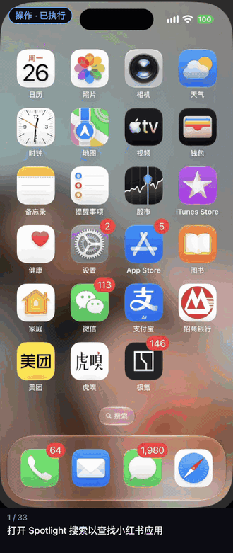
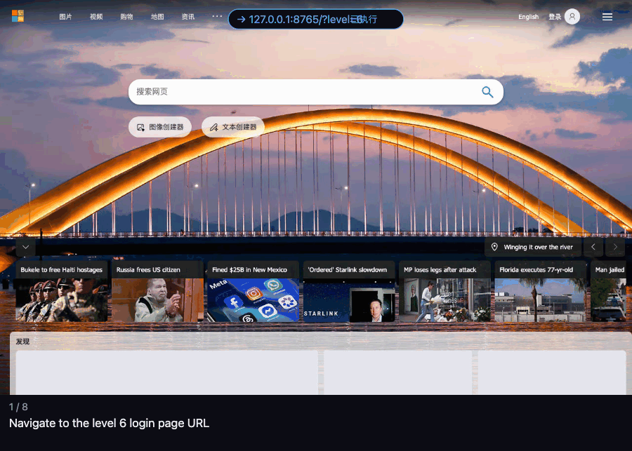
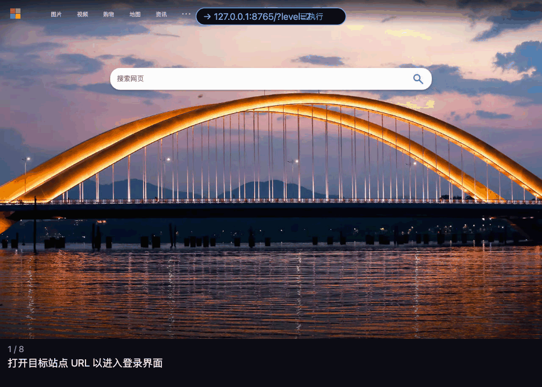

# seek-use

**一段话交代，它在你的屏幕上把事做完。**

通用的 Computer Use Agent。它像人一样看屏幕、用鼠标和键盘操作：不需要应用开放接口，也不用为每个应用单独适配，
一次任务可以跨好几个应用、跨电脑和手机。用便宜的 DeepSeek V4.1 Flash 就能跑通。

> 目前支持 Apple Silicon Mac，见[安装和使用](#安装和使用)。

https://github.com/user-attachments/assets/2726f63b-eeec-4f23-b9e0-c69c1f086be6

<sub>视频里的任务只有一段话：在 Chrome 登录智谱 BigModel → 到 iPhone 短信里读验证码填回去 → 截图账户余额 → 发到 Mac 微信的「文件传输助手」。
原速 7 分 58 秒，在 3 个应用之间切换，33 步操作，0 次人工干预（视频为加速剪辑）。</sub>

**MobileWorld 官方榜 77.78%（GUI-only 总榜第二、Agentic 类第一）· WebArena-Verified Hard 集 88.3%**，全程只用 DeepSeek V4.1 Flash。

## 它能做什么

把你平时要亲手点完的事交给它，不用告诉它按钮在哪：

| 任务类型 | 真实运行 |
| --- | --- |
| **跨应用办完一件事** | 登录网站、到手机短信取验证码、截图、发微信（上方视频） |
| **跨 App 查信息、做比较** | Android：在京东、淘宝、拼多多搜同一款水比价；iPhone：从小红书找书店合集，再到大众点评查评分和人均 |
| **过验证码** | 按提示顺序点字、多选图片格子 |
| **网页前台与后台** | WebArena-Verified 电商前台和管理后台的 Hard 题 |

| **Android**：三个购物 App 比价 | **iPhone**：小红书找书店，大众点评查评分 |
| --- | --- |
|  |  |

| **按顺序点字验证码** | **多选图片验证码** |
| --- | --- |
|  |  |

以上都是真实运行的回放，每一帧是一步操作，底部文字是模型自己写的这一步说明。
Browser、Android、iPhone 和基准成绩的合集见[这段视频](https://github.com/user-attachments/assets/5981825e-e039-445a-910e-c8076bb05c5c)。

能操作的界面：**Mac 上的应用窗口 · 浏览器 · Android 真机或模拟器 · iPhone（通过 iPhone 镜像）**。

## 为什么便宜的模型也能做对

flash 模型也会点错、看错、自作主张。seek-use 不赌模型每一步都对，而是让每一步都经过检查：

**规划 → 提议动作 → 校验、执行、设备确认 → 前后截图对比验证**

- **点了没反应**：对比前后截图就能发现，当步重试或换一条路。
- **输入框里的字不对**：输入后核对，不会带着错往下走。
- **模型给自己加了你没说的限制**：规划时被拦下，退回重来。

做没做完也不由模型自己说了算：最终结果要经过审核，读到的数据绑定来源截图，比较和计算交给沙箱执行。

公开基准（pass@1，按基准自带的评测器判分，没有更强的模型兜底）：

| 基准 | 范围 | 结果 |
| --- | --- | --- |
| MobileWorld | Android，GUI-only 子集 | **91/117（77.78%）**，[已上官方榜单](https://github.com/Tongyi-MAI/MobileWorld/issues/68) |
| WebArena-Verified | Shopping / Shopping Admin，Hard 集 | **98/111（88.3%）** |

MobileWorld 的成绩由官方用我们上传的全部轨迹复现，收录在 [MobileWorld 榜单](https://github.com/Tongyi-MAI/MobileWorld)，
目前在 GUI-only 总榜排第二、Agentic 类第一。预算按规划轮次计（每题 10 到 75 轮不等），GUI 动作次数不设上限，
一轮规划里可以有多次 GUI 动作。
两个基准各抽样 10 条运行轨迹的回放和官方评分见 [benchmarks/](benchmarks/README.md)。

## 看得见、停得下、查得到

- **看得见**：在 Mac 上运行时，屏幕上有动作光标、窗口光晕和状态气泡，实时显示它在想什么、要点哪里。
- **停得下**：随时按 Esc、点菜单栏图标或面板上的「停止」结束任务。
- **查得到**：每次运行都记录模型调用、实际动作和截图，有运行记录页和逐步回放。

## 目前的局限

- **不算快**：每一步都要观察、规划和检查，通常几秒一步，长任务要几分钟。
- **占用前台**：操作 Mac 应用和 iPhone 镜像用的是真实的鼠标键盘，运行期间别去动它们；浏览器默认在后台的 headless Chromium 里运行。
- **精细识别不保证一次对**：小字、扭曲的验证码可能读错，读错后会重试。
- **只有 Mac 版**：安装包目前只支持 Apple Silicon Mac（M 系列芯片）。

## 安装和使用

seek-use 是一个本地 MCP 服务，界面操作在你的电脑上运行，模型服务由你自己配置，截图只发给你配置的模型服务。

**1. 安装。** 需要 [uv](https://docs.astral.sh/uv/getting-started/installation/)，Python 3.11 由 uv 自动准备：

```sh
uv tool install --python 3.11 "seek-use[browser] @ https://github.com/hyechow/seek-use/releases/download/v0.1.0a1/seek_use-0.1.0a1-cp311-cp311-macosx_11_0_arm64.whl"
uvx --from playwright==1.60.0 playwright install chromium
```

要操作 Android，把 `[browser]` 换成 `[browser,android]`。装好后终端里就有 `seek-use` 命令，`which seek-use` 能看到它的完整路径。
以后升级：用新版本的链接再运行一次 `uv tool install --force ...`。

**2. 配置模型。** 模型设置从环境变量读取，写进 shell 配置（如 `~/.zshrc`）或在启动宿主前导出：

| 变量 | 值 |
| --- | --- |
| `SEEK_USE_MODEL` | `deepseek-flash`，即 DeepSeek V4.1 Flash，上面的基准成绩用的就是它 |
| `SEEK_USE_BASE_URL` | 模型服务地址，OpenAI 兼容接口，如 `https://your-api.example/v1` |
| `SEEK_USE_API_KEY` | 你的 API Key |
| `SEEK_USE_BACKEND` | 默认 `deepseek`；使用通用 Chat Completions 接口时设为 `chat_completions` |

检查一下模型和浏览器是否就绪：

```sh
seek-use check browser
```

**3. 接到你的 AI 助手。**

- **DeepSeek Harness**：一条命令写好 dsh 的 MCP 配置和审批插件（任务在真实浏览器或设备上运行前会先问你）：

  ```sh
  seek-use setup deepseek-harness
  ```

- **Claude Code**：项目根目录的 `.mcp.json` 或 `claude --mcp-config` 用的配置文件里加入（`command` 换成 `which seek-use` 的输出）：

  ```json
  {
    "mcpServers": {
      "seek-use": {
        "command": "/Users/you/.local/bin/seek-use",
        "env": {
          "SEEK_USE_MODEL": "${SEEK_USE_MODEL}",
          "SEEK_USE_BASE_URL": "${SEEK_USE_BASE_URL}",
          "SEEK_USE_API_KEY": "${SEEK_USE_API_KEY}",
          "SEEK_USE_BACKEND": "${SEEK_USE_BACKEND}"
        }
      }
    }
  }
  ```

- **Codex**：在 `~/.codex/config.toml` 里加入（`command` 同样换成 `which seek-use` 的输出）：

  ```toml
  [mcp_servers.seek-use]
  command = "/Users/you/.local/bin/seek-use"
  env_vars = ["SEEK_USE_MODEL", "SEEK_USE_BASE_URL", "SEEK_USE_API_KEY", "SEEK_USE_BACKEND"]
  tool_timeout_sec = 120
  ```

- **命令行**：不接宿主也能直接跑一个任务：`seek-use run browser "查询北京今天的天气"`。

**4. 说一句话。** 重启宿主后，直接在对话里输入：

> 使用 seek-use，在独立浏览器中查询北京今天的天气。

操作 Mac 应用窗口或 iPhone 镜像时，要在「系统设置 → 隐私与安全性」里给运行 seek-use 的应用（终端或宿主应用）
打开**屏幕录制**和**辅助功能**权限，`seek-use check macos` 会告诉你缺哪一项。

## 许可证

见 [LICENSE](LICENSE)。
