# 基准测试材料

两个基准各抽 10 条完整运行，全程只用 DeepSeek V4.1 Flash，以回放 GIF 展示 harness 一步步怎么做，
以及官方评测器怎么判分。完整结果数据量大，这里只放抽样，不是全量结果。

## MobileWorld（GUI-only）：10 条抽样，8 条通过、2 条失败

| # | 题目 | 官方评分 | 动作 | 用时 | 日期 | 回放 |
| ---: | --- | --- | ---: | ---: | --- | --- |
| 1 | CheckDeduplicatedEventsTask | ✅ 1.0 | 8 | 128 秒 | 2026-10-20 | [GIF](mobileworld/01-CheckDeduplicatedEventsTask-pass.gif) |
| 2 | AdjustFontIconMinimumTask | ✅ 1.0 | 7 | 93 秒 | 2026-10-20 | [GIF](mobileworld/02-AdjustFontIconMinimumTask-pass.gif) |
| 3 | CheckConferenceAndSendSmsTask2 | ✅ 1.0 | 14 | 227 秒 | 2026-10-24 | [GIF](mobileworld/03-CheckConferenceAndSendSmsTask2-pass.gif) |
| 4 | CheckInvoiceTask1 | ✅ 1.0 | 2 | 98 秒 | 2026-10-22 | [GIF](mobileworld/04-CheckInvoiceTask1-pass.gif) |
| 5 | ReadQwen3PaperTask3 | ✅ 1.0 | 2 | 230 秒 | 2026-10-22 | [GIF](mobileworld/05-ReadQwen3PaperTask3-pass.gif) |
| 6 | SendWaiverTask | ✅ 1.0 | 10 | 132 秒 | 2026-10-22 | [GIF](mobileworld/06-SendWaiverTask-pass.gif) |
| 7 | MastodonNewPostTask | ✅ 1.0 | 6 | 125 秒 | 2026-10-24 | [GIF](mobileworld/07-MastodonNewPostTask-pass.gif) |
| 8 | ChangeWallpaperTask | ✅ 1.0 | 10 | 190 秒 | 2026-10-22 | [GIF](mobileworld/08-ChangeWallpaperTask-pass.gif) |
| 9 | InvoiceReceiptCopyAskUserTask | ❌ 0.0：Target folder 'Documents/expense/invoice' does not exist | 4 | 196 秒 | 2026-10-24 | [GIF](mobileworld/09-InvoiceReceiptCopyAskUserTask-fail.gif) |
| 10 | AdjustBrightnessMaximumTask | ❌ 0.0：Brightness is not at maximum level, current: 244/255 | 4 | 94 秒 | 2026-10-11 | [GIF](mobileworld/10-AdjustBrightnessMaximumTask-fail.gif) |

点图看大图（✅ 和 ❌ 是官方评测结果）：

<table>
<tr><td align="center" valign="top" width="20%"><a href="mobileworld/01-CheckDeduplicatedEventsTask-pass.gif">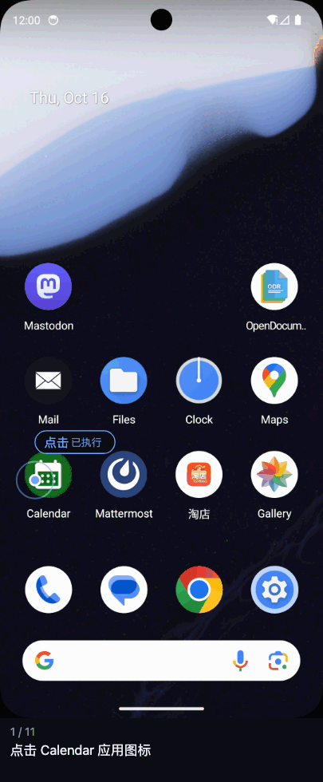</a> ✅ CheckDeduplicatedEventsTask</td><td align="center" valign="top" width="20%"><a href="mobileworld/02-AdjustFontIconMinimumTask-pass.gif">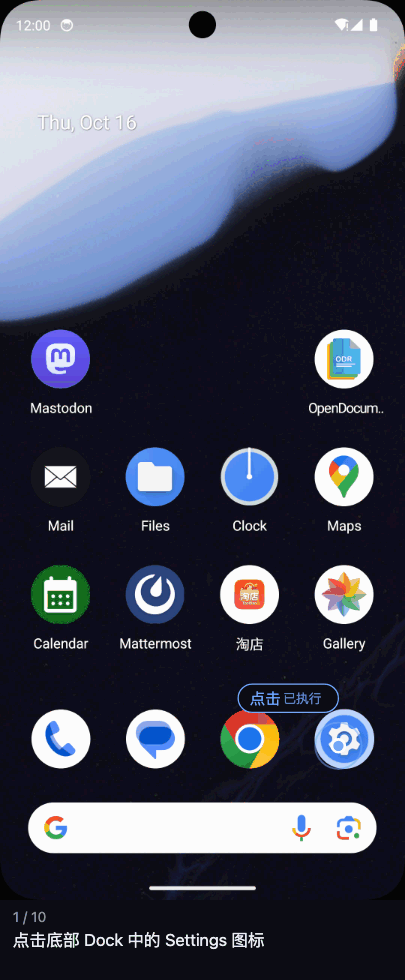</a> ✅ AdjustFontIconMinimumTask</td><td align="center" valign="top" width="20%"><a href="mobileworld/03-CheckConferenceAndSendSmsTask2-pass.gif">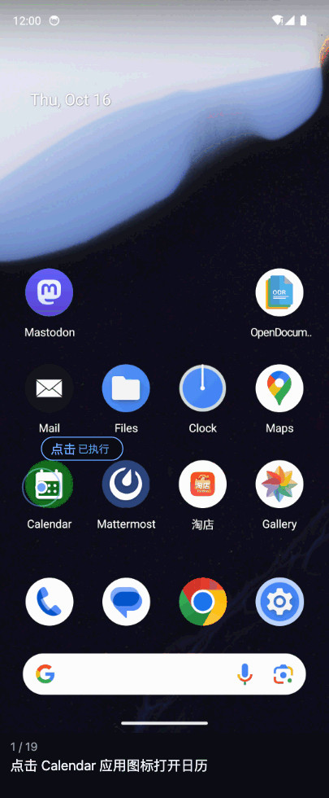</a> ✅ CheckConferenceAndSendSmsTask2</td><td align="center" valign="top" width="20%"> ✅ CheckInvoiceTask1</td><td align="center" valign="top" width="20%"><a href="mobileworld/05-ReadQwen3PaperTask3-pass.gif">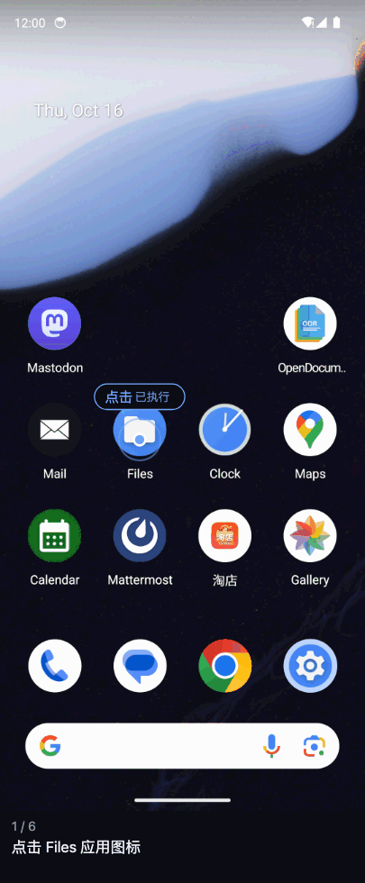</a> ✅ ReadQwen3PaperTask3</td></tr>
<tr><td align="center" valign="top" width="20%"><a href="mobileworld/06-SendWaiverTask-pass.gif">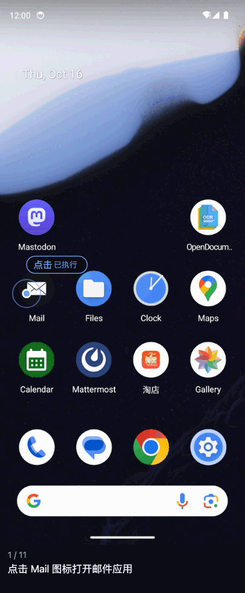</a> ✅ SendWaiverTask</td><td align="center" valign="top" width="20%"><a href="mobileworld/07-MastodonNewPostTask-pass.gif">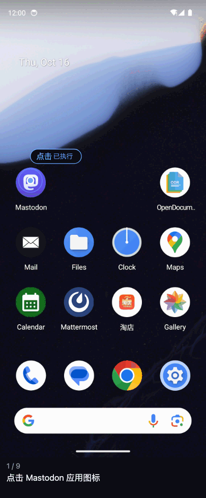</a> ✅ MastodonNewPostTask</td><td align="center" valign="top" width="20%"><a href="mobileworld/08-ChangeWallpaperTask-pass.gif">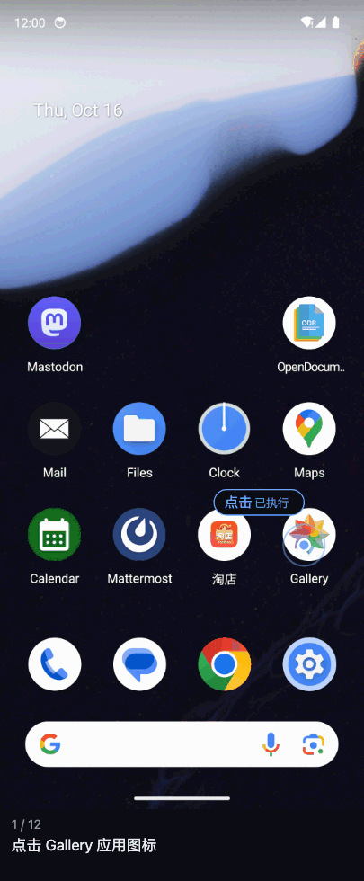</a> ✅ ChangeWallpaperTask</td><td align="center" valign="top" width="20%"><a href="mobileworld/09-InvoiceReceiptCopyAskUserTask-fail.gif">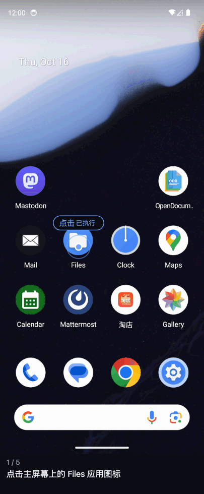</a> ❌ InvoiceReceiptCopyAskUserTask</td><td align="center" valign="top" width="20%"><a href="mobileworld/10-AdjustBrightnessMaximumTask-fail.gif">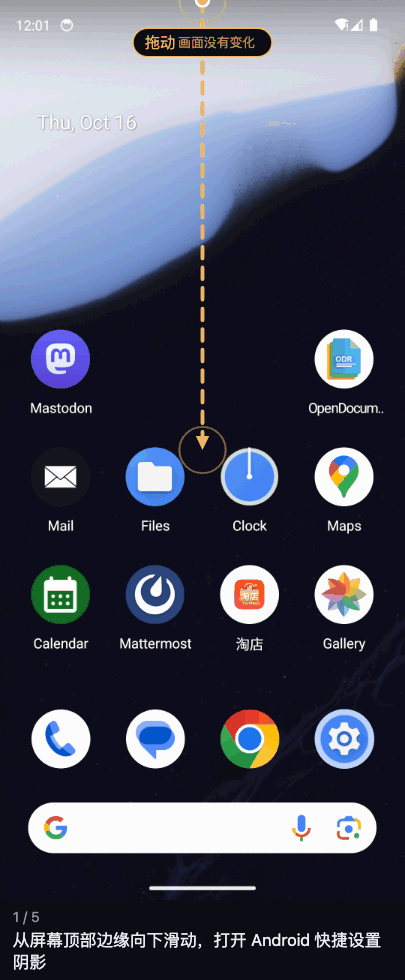</a> ❌ AdjustBrightnessMaximumTask</td></tr>
</table>

动作是实际执行成功的设备操作次数，用时是整条运行的耗时。GIF 里每一帧是一步，底部的文字是模型对这一步的说明
（有的是英文，那是模型自己写的）。

### 评分来自谁

由 MobileWorld 后端的 `/task/eval` 按设备和应用的最终状态判定，和 agent 自己说“完成”无关。
两条失败的运行里，评测器给的理由是上表“官方评分”一列，agent 自己的说法是：

- **AdjustBrightnessMaximumTask**：agent 认为亮度已经调到最大（回答里写的是 100），评测器读到的是 244/255。
- **InvoiceReceiptCopyAskUserTask**：agent 在 Download 里找到了唯一符合条件的 invoice_2025_001.pdf，但题目没有说明
  “专门收录发票的文件夹”叫什么、在哪，它就此停下，说不知道该复制到哪里；
  评测器检查到目标文件夹 Documents/expense/invoice 不存在，判 0 分。

## WebArena-Verified（Shopping / Shopping Admin）：10 条抽样，9 条通过、1 条失败

样本来自 10 月 27 日至 28 日运行的 20 道 Hard 题，每题一条运行。

| # | 题号 | 站点 | 官方评分 | 动作 | 用时 | 日期 | 回放 |
| ---: | ---: | --- | --- | ---: | ---: | --- | --- |
| 1 | 21 | Shopping | ✅ 1.0 | 6 | 279 秒 | 2026-10-27 | [GIF](webarena/01-WebArena-21-pass.gif) |
| 2 | 63 | Shopping Admin | ✅ 1.0 | 8 | 171 秒 | 2026-10-27 | [GIF](webarena/02-WebArena-63-pass.gif) |
| 3 | 113 | Shopping Admin | ✅ 1.0 | 12 | 322 秒 | 2026-10-27 | [GIF](webarena/03-WebArena-113-pass.gif) |
| 4 | 142 | Shopping | ✅ 1.0 | 9 | 254 秒 | 2026-10-27 | [GIF](webarena/04-WebArena-142-pass.gif) |
| 5 | 200 | Shopping Admin | ✅ 1.0 | 6 | 141 秒 | 2026-10-27 | [GIF](webarena/05-WebArena-200-pass.gif) |
| 6 | 226 | Shopping | ✅ 1.0 | 19 | 428 秒 | 2026-10-27 | [GIF](webarena/06-WebArena-226-pass.gif) |
| 7 | 320 | Shopping | ✅ 1.0 | 9 | 149 秒 | 2026-10-28 | [GIF](webarena/07-WebArena-320-pass.gif) |
| 8 | 499 | Shopping Admin | ✅ 1.0 | 18 | 260 秒 | 2026-10-27 | [GIF](webarena/08-WebArena-499-pass.gif) |
| 9 | 701 | Shopping Admin | ✅ 1.0 | 12 | 137 秒 | 2026-10-27 | [GIF](webarena/09-WebArena-701-pass.gif) |
| 10 | 147 | Shopping | ❌ 0.0 | 20 | 393 秒 | 2026-10-28 | [GIF](webarena/10-WebArena-147-fail.gif) |

点图看大图（✅ 和 ❌ 是官方评测结果）：

<table>
<tr><td align="center" valign="top" width="50%"><a href="webarena/01-WebArena-21-pass.gif">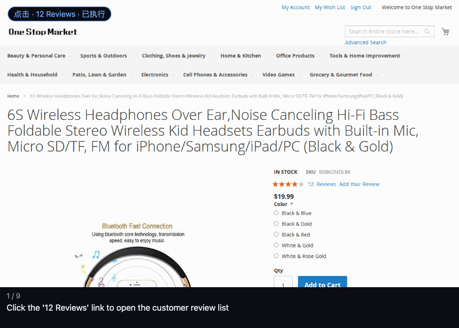</a> ✅ #21 · Shopping</td><td align="center" valign="top" width="50%"><a href="webarena/02-WebArena-63-pass.gif">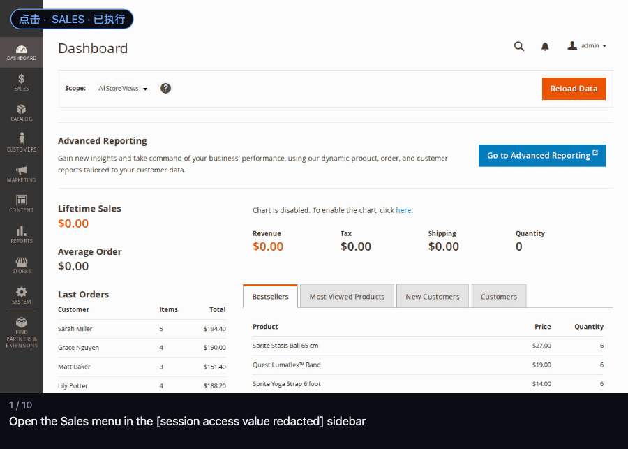</a> ✅ #63 · Shopping Admin</td></tr>
<tr><td align="center" valign="top" width="50%"><a href="webarena/03-WebArena-113-pass.gif">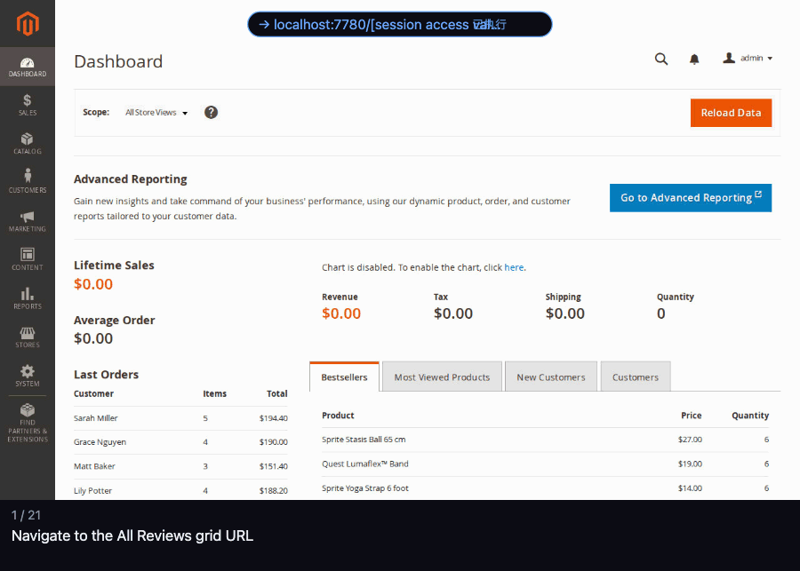</a> ✅ #113 · Shopping Admin</td><td align="center" valign="top" width="50%"><a href="webarena/04-WebArena-142-pass.gif">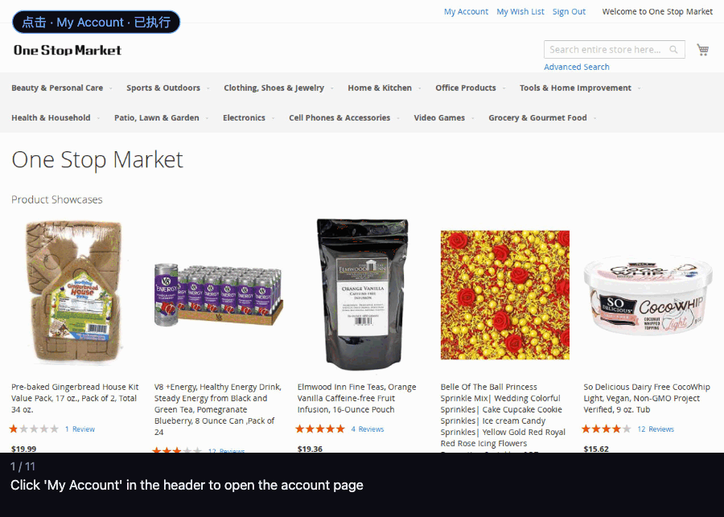</a> ✅ #142 · Shopping</td></tr>
<tr><td align="center" valign="top" width="50%"><a href="webarena/05-WebArena-200-pass.gif">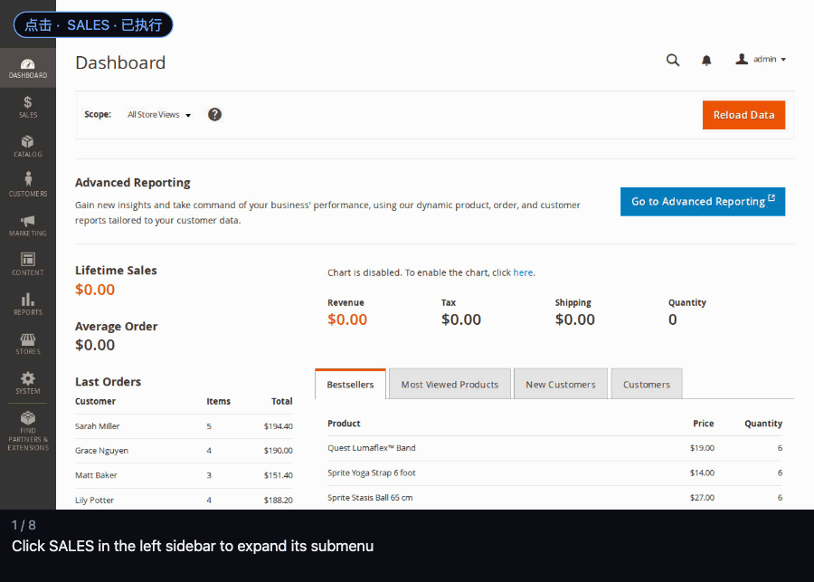</a> ✅ #200 · Shopping Admin</td><td align="center" valign="top" width="50%"><a href="webarena/06-WebArena-226-pass.gif">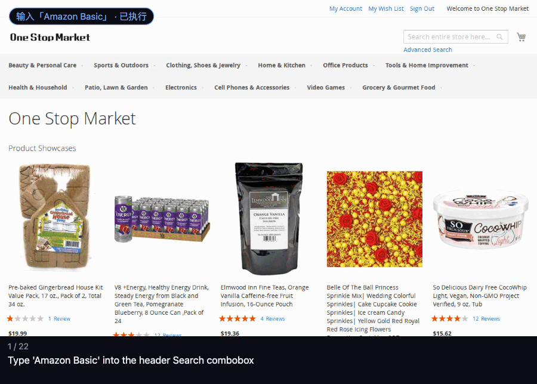</a> ✅ #226 · Shopping</td></tr>
<tr><td align="center" valign="top" width="50%"><a href="webarena/07-WebArena-320-pass.gif">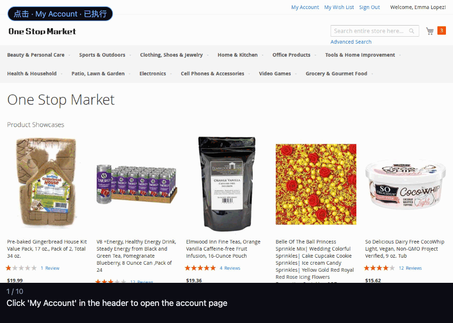</a> ✅ #320 · Shopping</td><td align="center" valign="top" width="50%"><a href="webarena/08-WebArena-499-pass.gif">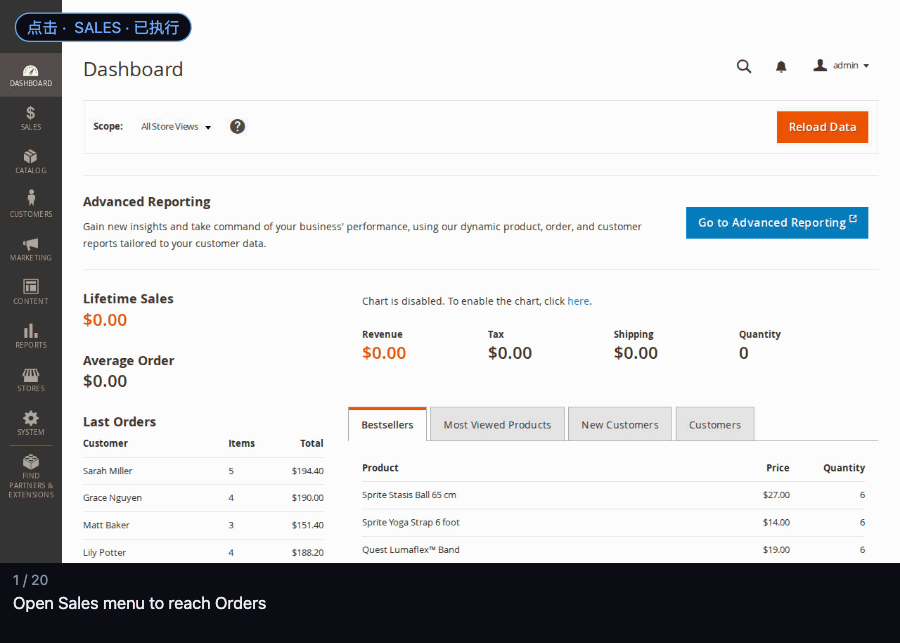</a> ✅ #499 · Shopping Admin</td></tr>
<tr><td align="center" valign="top" width="50%"><a href="webarena/09-WebArena-701-pass.gif">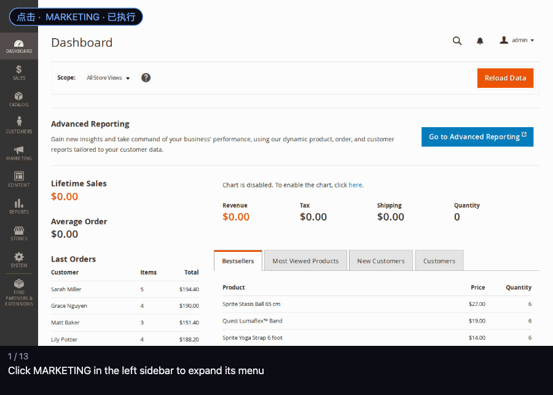</a> ✅ #701 · Shopping Admin</td><td align="center" valign="top" width="50%"><a href="webarena/10-WebArena-147-fail.gif">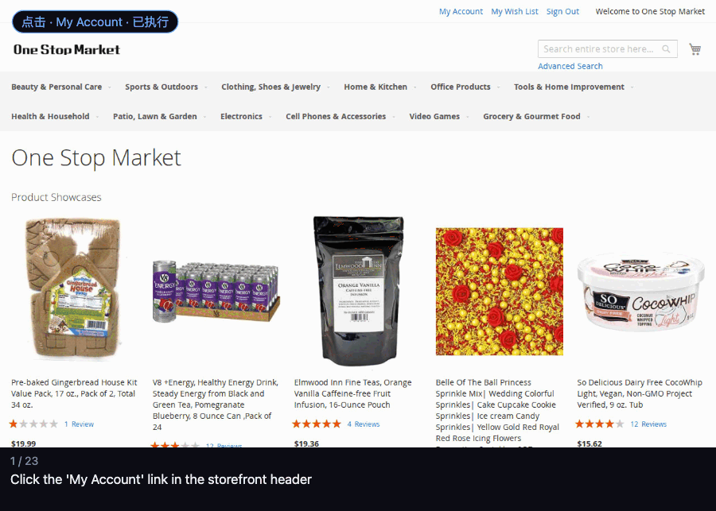</a> ❌ #147 · Shopping</td></tr>
</table>

动作是实际执行成功的浏览器操作次数，用时是整条运行的耗时。GIF 里每一帧是一步，底部的文字是模型对这一步的说明（英文）。

题目原文（英文）：

- #21：Get name(s) of reviewer(s) who mention ear cups being small for the product on the current page
- #63：Get customer email(s) who completed the second most number of orders in the entire history
- #113：Return the customer nickname(s) who gave a rating of 3 stars or below for Olivia zip jacket
- #142：Return how much I spent on hair care and hair style shopping during Jan 2023 without considering shipping and handling fee. Return the value as a number (e.g., 10.99) only, without any additional details
- #200：Get the billing name of the oldest complete order.
- #226：What is the price range for products from Amazon basic?. Return an object with keys "min" and "max" (as numbers, e.g., 10.99) only, without any additional details.
- #320：How much refund should I expect from my orders canceled, if any, in Feb 2023, including shipping fee.. Return the value as a number (e.g., 10.99) only, without any additional details.
- #499：Update order #304 with the USPS tracking number 13849373987
- #701：Create a new marketing price rule called "Mother's day sale" for all registered customers that offers 15% discount on checkout on all their cart
- #147：Get the size of the picture frame I bought in 2022. Return a list of objects with keys "width" and "height".

### 评分来自谁

由 WebArena-Verified 官方评测器按 agent 的最终回答和网络请求判定（读取类题看回答，修改类题还要核对发出的请求），
和 agent 自己说“完成”无关。

唯一的失败是 #147：agent 要在 2022 年的订单里找出买过的相框尺寸，在 20 轮规划预算用完时还没查完候选订单，
评测器判定为 UNKNOWN_ERROR，没有取到数据，判 0 分。
